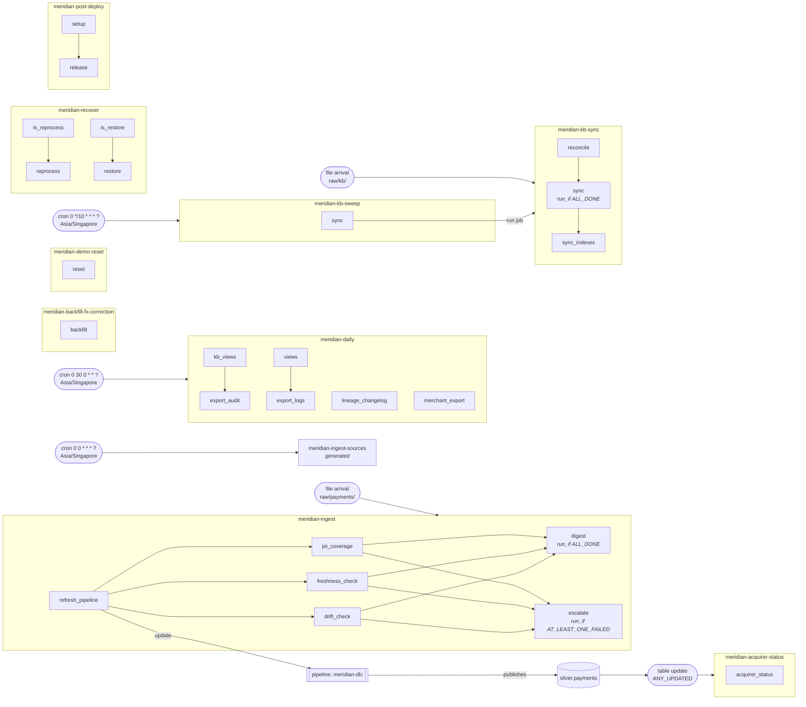

# Job graph (target `prod`)

BUILD: generated by `scripts/job_graph.py` from the bundle configuration on 2026-10-17 23:37 UTC; do not edit by hand.
Edges are declared in the bundle: triggers, task dependencies, run-job and pipeline tasks, and the tables that table-update triggers watch. Writes that no bundle declares show up in table history.

